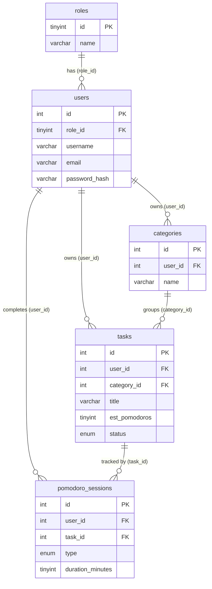
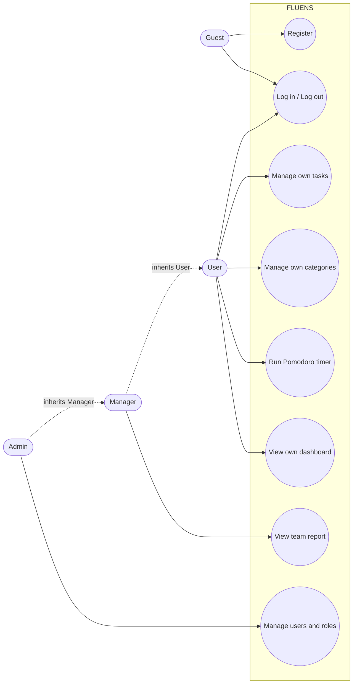

# Project Proposal: PHP + MySQL Application

> **Course:** J620-002-4:2020 Front-End Software Development (Level 4)
> **Competency Unit:** J620-002-4:2020-C01

---

## 1. Student Details

| Field          | Your Answer          |
| -------------- | -------------------- |
| Candidate Name | LIM AN THYE          |
| NRIC Number    | [ Your NRIC number ] |
| Date Submitted | 12/10/2026           |

---

## 2. Project Title

**FLUENS: Pomodoro To-Do List**

### One-line summary

A web app where users plan tasks and work on them with a built-in Pomodoro timer that records their progress.

---

## 3. Problem Statement & Purpose

People often keep their to-do list in one place and their timer in another, so they lose focus and cannot see how much work they did. FLUENS joins both: users add tasks, start a focus session on a task, and see their progress on a dashboard. It is for students and small teams who want a simple way to stay focused.

---

## 4. Tech Stack

| Layer       | Technology |
| ----------- | ---------- |
| Markup      | HTML5      |
| Styling     | CSS3       |
| Server-side | PHP        |
| Database    | MySQL      |

---

## 5. Types of Users (Roles)

| Role    | Description                                                    |
| ------- | -------------------------------------------------------------- |
| Admin   | Manages user accounts and roles, and can view the team report. |
| Manager | Views the team report (read-only).                             |
| User    | Default role. Manages their own tasks and uses the timer.      |

All three roles can also use the normal app features (own tasks, categories, timer, dashboard).

### Role-Based Access Matrix

| Feature / Page                          | Admin | Manager | User | Guest |
| --------------------------------------- | :---: | :-----: | :--: | :---: |
| Register / Login                        |  ✅   |   ✅    |  ✅  |  ✅   |
| Own tasks, categories, timer, dashboard |  ✅   |   ✅    |  ✅  |  ❌   |
| Team report                             |  ✅   |   ✅    |  ❌  |  ❌   |
| Manage users and roles                  |  ✅   |   ❌    |  ❌  |  ❌   |

---

## 6. Features

### 6.1 Core Features (must have)

- [x] User registration and login
- [x] Role-based access control (each role sees/does different things)
- [x] Data management (Create, Read, Update, Delete)
- [x] Pomodoro timer that saves each finished session
- [x] Tasks with categories

### 6.2 Extra Features (nice to have)

- [x] Break suggestion after each focus session (long break every 4th)
- [x] Dashboard with today's Pomodoros and total focus minutes

### 6.3 Feature Descriptions

| Feature              | Description                                                               | Role(s)        |
| -------------------- | ------------------------------------------------------------------------- | -------------- |
| Register and login   | Sign up and log in. New accounts get the User role.                       | Everyone       |
| Tasks and categories | Add, edit, complete and delete your own tasks and categories.             | All roles      |
| Pomodoro timer       | 25-minute focus and 5/15-minute break timer. Finished sessions are saved. | All roles      |
| Team report          | Table of each user's tasks done and focus time.                           | Admin, Manager |
| User management      | Change a user's role or delete a user.                                    | Admin          |

---

## 7. Data Management System

| Data / Entity     | Create          | Read                              | Update       | Delete |
| ----------------- | --------------- | --------------------------------- | ------------ | ------ |
| Tasks             | Owner           | Owner                             | Owner        | Owner  |
| Categories        | Owner           | Owner                             | None         | Owner  |
| Pomodoro sessions | Owner (timer)   | Owner; Admin and Manager (totals) | None         | None   |
| Users             | Guest (sign-up) | Admin                             | Admin (role) | Admin  |

"Owner" means the logged-in user, and only for their own data.

---

## 8. Database Design

5 tables and 6 foreign keys.

### Entity Relationship Diagram (ERD)

---

## 9. Use Case Diagram

---

## 10. Presentation Checklist

- [ ] Can explain the purpose of the application
- [ ] Can justify design choices (why this database structure, why these roles)
- [ ] Can demo every role
- [ ] Can answer questions about my own code
- [ ] Submitted on time
