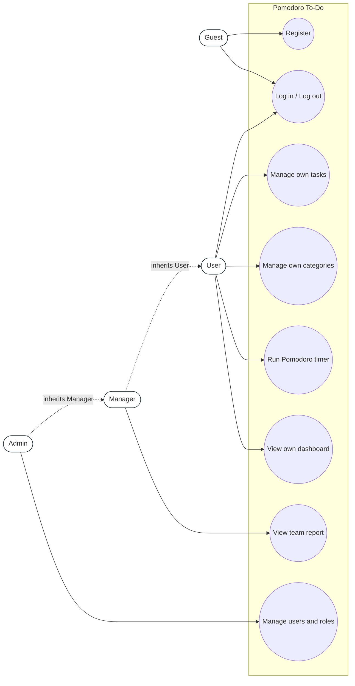
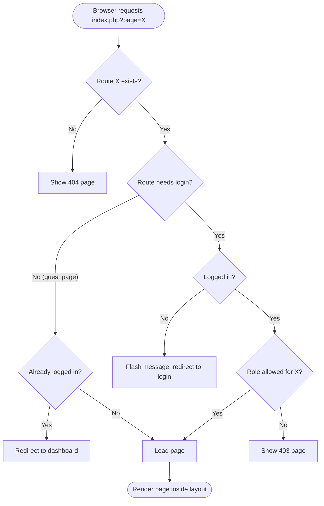
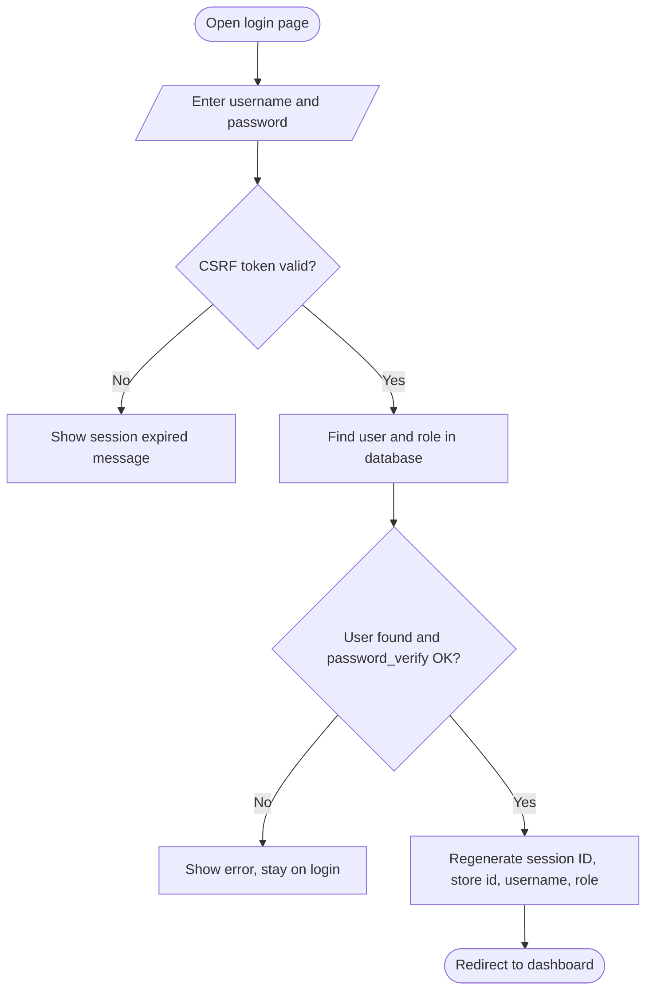
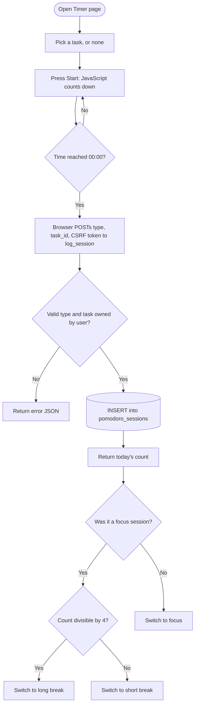
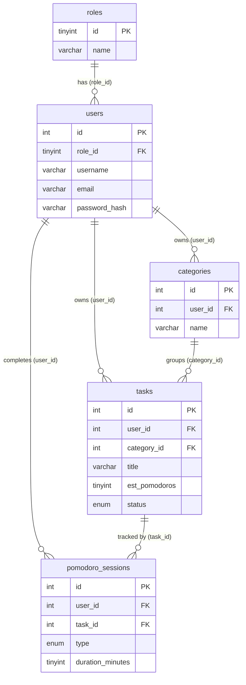

# Pomodoro To-Do: Use Cases, Flowcharts and Database Diagram

Paste each block into https://mermaid.live (or any Mermaid viewer) to export a PNG/PDF for your report.

## 1. Use case diagram (roles and what each can do)

## 2. Flowchart: request routing and role check

## 3. Flowchart: login

## 4. Flowchart: one Pomodoro session (data flow)

## 5. Entity relationship diagram

